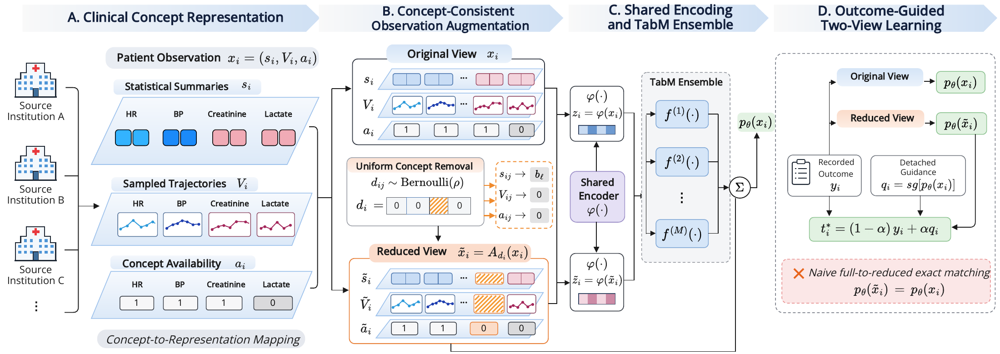

# COVAL

### Concept-Consistent View Learning for Clinical Prediction under Observation-Availability Shift

Clinical measurements do not arrive in the same pattern at every hospital. COVAL trains a predictor to remain useful when a clinical concept becomes unavailable by removing **all of that concept's representations together** and learning from both the original and reduced views.



> **This is a small, data-free reference release.** It contains the core predictor, concept-level augmentation, and two-view objective. The example uses generated tensors; no patient records, institution-specific preprocessing pipeline, or pretrained weights are included.

## At a glance

| Component | What it does |
| :-- | :-- |
| Concept map | Links each summary column and trajectory channel to its clinical concept. |
| Coherent reduced view | Replaces all summary coordinates of a removed concept with their source-fitted missing representation, and zeroes its trajectory and availability indicator. |
| Shared predictor | Encodes summaries and sampled trajectory values, then predicts with the official [TabM](https://github.com/yandex-research/tabm) ensemble backbone. |
| Two-view learning | Uses outcomes for both views and a detached original-view ensemble prediction as auxiliary guidance for the reduced view. |

At inference, use the **original view only**. No target-hospital adaptation, extra teacher, or second inference pass is required.

## Quick start

Python 3.9+ is required. From this directory:

```bash
python -m venv .venv
source .venv/bin/activate
pip install -e .
python examples/train_synthetic.py
python -m unittest discover -s tests -v
```

The synthetic run prints three mean per-view losses and five example probabilities. It is a **functional smoke test**, not a reproduction of the paper's clinical results.

## Use with your own tensors

```python
import torch
from coval import COVAL, ConceptMap, train_step, predict_proba

# One source-fitted bin-edge tensor per numerical feature.
model = COVAL(summary_bins, trajectory_bins)

concept_map = ConceptMap(
    summary_to_concept=torch.tensor(summary_concept_ids, dtype=torch.long),
    trajectory_to_concept=torch.tensor(trajectory_concept_ids, dtype=torch.long),
    missing_summary=torch.tensor(source_fitted_missing_summary),
    num_concepts=num_concepts,
)

optimizer = torch.optim.AdamW(model.parameters(), lr=1e-3, weight_decay=3e-4)
for epoch in range(num_epochs):
    for inputs, targets in training_loader:
        train_step(
            model, inputs, targets, optimizer, concept_map,
            rho=0.25, alpha=0.5, warmup=epoch < 2,
        )

probabilities = predict_proba(model, evaluation_inputs)
```

`training_loader` and `evaluation_inputs` are application-provided. The core API expects:

| Key | Shape | Meaning |
| :-- | :-- | :-- |
| `summary` | `[batch, L]` | Source-normalized numerical summaries. |
| `clock` | `[batch, Q, J]` | Source-normalized values sampled along each retained concept's observation interval. |
| `observed` | `[batch, J]` | 1 if a retained trajectory concept was observed, otherwise 0. |
| `targets` | `[batch]` | Binary outcome labels, supplied separately from inputs. |

`summary_to_concept` has length `L`; `trajectory_to_concept` has length `J`. Both contain zero-based IDs in `[0, num_concepts)`. Multiple summary columns may share one concept ID. `missing_summary` has length `L` and should contain the value obtained by applying the **source-fitted summary transform to each source median**. It need not be zero. Keep the concept order fixed across training and inference.

The model expects already-prepared tensors and numerical bin edges. Fit imputation, normalization, binning, and any feature selection **on the fitting sources only**. Do not use held-out institutions or outcome columns to estimate these transformations. The included example uses fixed bins only because its data are synthetic.

## Objective

For a minibatch, draw one Bernoulli removal decision per patient and concept with probability `rho`. A removed concept disappears from every input representation to which it is mapped. Let `z` and `z̃` be the original- and reduced-view ensemble logits, `y` the recorded outcome, and `q = stop_gradient(mean_k sigmoid(z_k))`. COVAL minimizes

```text
L = BCE(z, y) + (1 - alpha) BCE(z̃, y) + alpha BCE(z̃, q).
```

The implementation uses a two-epoch outcome-only warmup, followed by paired training. The default study settings are `rho = 0.25`, `alpha = 0.5`, `k = 32`, embedding dimension `16`, and a two-block TabM backbone of width `512`. The synthetic example deliberately uses a smaller model so it runs quickly on a CPU.

## What's included

```text
coval/
  model.py          # Numerical embeddings, sampled-value pooling, TabM ensemble
  augmentation.py   # Concept mapping and synchronized removal
  training.py       # Two-view loss, train step, inference
examples/
  train_synthetic.py
tests/
  test_core.py
assets/
  coval_framework.png
```

The clinical cohorts have their own access rules and are **not redistributed here**. This release intentionally omits raw or processed patient data, internal cohort-building scripts, experiment orchestration, evaluation outputs, and trained checkpoints. The public code focuses on the method; the synthetic example cannot reproduce the manuscript's reported metrics.

## Acknowledgment

COVAL builds on the official [TabM implementation](https://github.com/yandex-research/tabm) and [rtdl-num-embeddings](https://github.com/yandex-research/rtdl-num-embeddings). Those packages are installed as dependencies; their source code is not copied into this release.

If you use this code, please cite the paper *COVAL: Concept-Consistent View Learning for Clinical Prediction under Observation-Availability Shift* and the TabM work. Full paper citation details can be added after publication.
